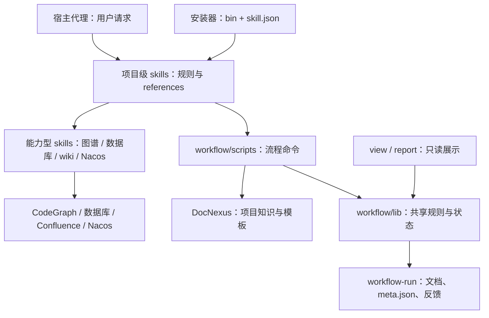

# 维护、测试与发布

[返回首页](../README.md) · [安装与升级](installation.md) · [工作流与命令](workflows.md) · [外部能力集成](integrations.md) · [团队共享、产物与模板](team-guide.md)

## 当前架构

本文对应 0.30.0（2026-10-30），包括 F2 业务场景清单、F3 技术澄清、需求与方案证据失效规则，以及锁定依赖和发布包验证。

安装分发与任务运行分开。运行时由宿主代理读取 skill 规则、调用脚本；workflow-run 本身不启动常驻 Agent 服务。

| 部分 | 代码位置 | 职责 |
| --- | --- | --- |
| 安装分发 | `bin/`、各 skill 的 `skill.json` | 自动发现 skills，展开 `requires` 依赖，安装 / 链接、升级、卸载、自检；保留用户配置 |
| 流程规则 | 各 skill 的 `SKILL.md.tpl`、`references/` | 安装后生成 `SKILL.md`；定义触发边界、阶段、确认点和按需读取的细节 |
| 命令入口 | `workflow/scripts/` | 画像、需求、运行、审查范围、产物收尾、模板、知识检索与报告等命令 |
| 共享核心 | `workflow/lib/` | 路径和数据模型、统一读取快照、元信息锁、版本、运行门禁、代码证据与可恢复收尾 |
| 能力型 skills | `code-graph/`、`database-query/`、`md-to-wiki/`、`nacos-config/` | 各自执行代码图谱查询、SQL、wiki 读写或 Nacos 只读查询，连接与凭据留在对应目录 |
| 数据与展示 | `workflow-run/`、`.docnexus/`、`view` / `report` | 保存需求产物、运行状态和知识；按需生成只读视图与统计 |



这张图表示职责和调用关系，每次请求只经过需要的分支。独立能力按各自入口调用；`workflow` 提供路由，`dev` 仅在用户显式选择开发工作流时启动。`nacos-config` 的 `requires` 为空，可独立读取远程配置，也可由 dev / project-review 按需调用；目前 Nacos 不纳入 `resolve.mjs status` 的集中能力探测，`inspect` 只检查本地候选，实际网络和鉴权由 `get` 验证。

共享核心随 workflow 安装，`lib` 不反向依赖 `scripts`，纯模型不做 I/O。需求 `meta.json` 保存绑定、版本索引和运行；Markdown 保存正文及发布 / 沉淀引用。只读展示不推进状态，文件存在不代表运行完成。完整流程通过方案版本、执行前代码快照、验证和审查证据校验阶段转换，产物收尾支持恢复与取消。

安装器仍统一接入必装组件 DocNexus，包括只选择 `nacos-config` 的安装；这属于安装策略，Nacos 读取脚本本身不调用 workflow 或 DocNexus。技术 / 上线方案的生效模板由 DocNexus 保存，首次按用户样例创建；包内审查、开发模板用于导入知识库，不是运行时的回退来源。

图解见 [docs/architecture.html](architecture.html)，共享核心、数据归属与证据门禁见 [workflow/references/architecture.md](../workflow/references/architecture.md)。

**业务场景、技术澄清与方案分开**：需要产品核对时，先在 F2 / B3 bind、start 并发布业务场景清单 `clarification.md`，逐轮更新、归档与等待反馈，纳入 view / report / PR 引用。feature 业务明确并完成现状调研后，进入 F3 澄清技术约束，再收尾 `requirement.md`（目标、范围、AC、决定与约束），最后在 F4 / B4 写 `plan.md`（实现设计、风险、实施与验证计划）。各文档独立版本归档，方案绑定需求 hash / 版本，需求变化使旧方案及下游证据失效。S 快速通道不落盘，历史 plan 不自动拆分。

升级会导入新增的 `dev/clarification-template.md` 与 `dev/requirement-template.md`。方案模板默认种子已改为引用需求文档；已有知识库模板不会被重装覆盖，未改过的默认模板可用 `seed-templates --update` 更新，团队定制的方案模板按 `/workflow template plan` 调整为引用需求并保留团队结构。

## 仓库结构与维护

本仓库（安装器）的结构如下，`.tpl` 后缀不会被任何平台误加载。它放在项目外，不要和项目里放产出的 `workflow-run/` 混在一起：


```
workflow-run（安装器仓库）/
├── bin/
│   ├── workflow-run.mjs                # 安装器入口（唯一实现，Node >= 22.13）：参数解析与 init / upgrade / doctor / uninstall / seed-templates / report / view / docs-repo 调度
│   ├── lib/                           # core / prompt / db / install / uninstall / docnexus / doctor / docsrepo
│   ├── skills.mjs                     # 读取各 skill 的 skill.json
│   └── seed-templates.mjs             # 把文档模板导入 DocNexus
├── package.json                       # npm 包信息（bin: workflow-run）
├── package-lock.json                  # 仓库测试依赖的锁定版本
├── shared/                            # 多个 skill 共用的参考文件（diff-collection-common.md、prd-fetch.md），安装时按 skill.json 的 shared 拷入
├── tests/                             # node 测试
├── evals/trigger-cases.json           # 多 skill 分流评估用例
├── scripts/eval-triggers.mjs          # 分流评估脚本
├── README.md                          # 安装与团队使用入口
├── docs/                              # 专题文档与图文教程
├── workflow/
│   ├── SKILL.md.tpl · skill.json
│   ├── lib/                           # 共享核心；不反向依赖 scripts 命令入口
│   │   ├── project.mjs                # 布局、画像、环境与配置
│   │   ├── requirement-read.mjs       # 需求目录与元信息读取
│   │   ├── requirements.mjs           # 绑定、版本归档与索引同步
│   │   ├── runs.mjs                   # 运行状态、阶段与完成校验
│   │   ├── run-gates.mjs              # 方案、验证、审查与交付门禁
│   │   ├── code-snapshot.mjs          # 代码内容摘要，绑定验证和审查证据
│   │   ├── artifact-finalize.mjs      # 可恢复的产物收尾
│   │   ├── path-match.mjs             # 共享范围匹配
│   │   ├── meta-store.mjs             # 写锁与原子存储
│   │   ├── document-model.mjs         # 标题、章节、表格等纯文本模型
│   │   ├── artifact-model.mjs         # 产物类型、元信息、审查与交付解析
│   │   └── workspace-read.mjs         # 工作区 / Git 采集、统一读取快照
│   ├── scripts/resolve.mjs            # 模板来源 / 画像 / 画像推断 / 能力探测
│   ├── scripts/lint-doc.mjs           # 对照模板检查生成的文档
│   ├── scripts/infer-profile.mjs      # 画像推断规则（resolve.mjs infer-profile 调用）
│   ├── scripts/knowledge.mjs          # 按分类列出相关的 DocNexus 文档
│   ├── scripts/artifacts.mjs          # 按分支汇总各 skill 产物与 wiki 发布记录
│   ├── scripts/report.mjs             # 本地效果报告
│   ├── scripts/pr-desc.mjs            # 按本分支产物生成 PR / MR 描述
│   ├── scripts/template.mjs           # 修改 / 创建模板：草稿 → 校验与影响 → 保存
│   ├── scripts/tables.mjs             # 找出改动涉及的数据库表
│   ├── scripts/artifact.mjs           # 草稿收尾 / 中断恢复 / 安全取消
│   ├── scripts/review-handoff.mjs     # 自动生成审查交接与结果结构
│   ├── scripts/requirement.mjs        # 产物按需求归档：绑定需求名、落盘路径、meta.json
│   ├── scripts/view.mjs               # 项目文档视图（本地静态页面）
│   ├── scripts/make-template.mjs      # 从样例文档抽模板骨架
│   ├── scripts/doc-sections.mjs       # 原解析导出入口，转交 lib/document-model.mjs
│   ├── references/                    # profile.md、capabilities.md、templates.md、docnexus.md、status.md、tables.md、requirements.md、codegraph.md（其他 skill 直接读对应文件）
│   └── profile.json.tpl               # 空画像，首次使用时由 agent 推断并经确认后填写
├── dev/
│   ├── SKILL.md.tpl · skill.json
│   └── references/                    # plan-template.md（方案模板）、delivery-template.md（交付模板）
├── project-review/
│   ├── SKILL.md.tpl · skill.json
│   └── references/                    # checklist.md.tpl、report.md.tpl（报告模板）、diff-strategy.md
├── code-graph/
│   ├── SKILL.md.tpl · skill.json
│   └── scripts/cg.mjs                 # 调 CodeGraph 库 + 扫源码补 MQ / 定时任务 / XML 表
├── database-query/
│   ├── SKILL.md.tpl · skill.json
│   ├── scripts/query.mjs              # 只读查询执行与表结构导出
│   └── references/                    # config.example.json、schema.md.tpl
├── md-to-wiki/
│   ├── SKILL.md.tpl · skill.json
│   ├── wiki-config.json.tpl
│   ├── references/                    # upload.md（上传通道）、troubleshooting.md（脚本与排错）
│   └── scripts/                       # md-to-wiki.mjs（转换 + 良构校验）、upload.mjs（REST 上传）
├── create-tech-md-doc/
│   ├── SKILL.md.tpl · skill.json
│   └── references/                    # diff-collection.md（分层采集）、prd.md（PRD 拉取）；模板不随包提供
└── create-release-md-doc/
    ├── SKILL.md.tpl · skill.json
    └── references/                    # diff-collection.md、prd.md；模板不随包提供
```


* 修改 `SKILL.md.tpl` 可调整触发词、工作流、输出模板（四环境共用同一份）。

* 项目相关的约定（配置中心、发布平台与 Region、定时任务注解、是否需要库表评审）不写在模板里，统一由 `workflow/profile.json` 提供；换项目时只需重新填画像。

* 安装后建议运行一次 `SHOW TABLES` 并 `DESCRIBE` 关键表，把结构补进

  `<env-dir>/database-query/references/schema.md`，能显著提升查库效率。

* SKILL.md 只保留主流程，细节放在各自的 `references/`，agent 需要时再读，减少每次触发占用的上下文。

## skill.json

每个 skill 目录下有一份 `skill.json`，是这个 skill 元数据的唯一来源：

```json
{
  "name": "create-tech-md-doc",
  "order": 6,
  "userFiles": {},
  "requires": ["workflow"],
  "optional": ["md-to-wiki", "create-release-md-doc"],
  "shared": ["diff-collection-common.md", "prd-fetch.md"],
  "templates": [{ "id": "template.md", "src": "template.md", "title": "技术方案模板", "summary": "...", "lint": { "requiredMeta": ["模板来源"] } }],
  "docnexus": { "category": "tech-design", "reason": "create-tech-md-doc skill 从技术方案中沉淀的决策、约定与风险", "readFrom": ["create-tech-md-doc", "dev"] }
}
```

| 字段 | 含义 |
| --- | --- |
| `name` / `order` | 与目录名一致；安装和展示顺序 |
| `userFiles` | 用户配置（安装后的相对路径 → 对应空模板的源路径或 `null`），重跑不覆盖，卸载时备份 |
| `templates` | 可由 DocNexus 接管的文档模板，知识库路径为 `templates/<skill>/<id>` |
| `requires` | 运行时必需的 skill（会调用它的脚本或读它的文件）；`--skills` 安装时自动带上 |
| `optional` | 协作但非必需的 skill：没装时跳过对应增强（如 PRD 读取、自审），不报错 |
| `shared` | 共享参考文件：源在仓库 `shared/`，安装时拷进本 skill 的 `references/`。仓库里只维护一份，装好后每个 skill 自带完整文件，运行时不依赖别的 skill |
| `docnexus` | 本 skill 写入 DocNexus 时的显式分类 `{ category, reason }`。写入时以调用方显式分类封存（`draft seal --category`），不走 DocNexus 的模型分类；项目可在 `workflow/profile.json` 的 `docnexus_categories` 里按 skill 覆盖。`readFrom` 列出开工前要参考哪些 skill 的沉淀，`knowledge.mjs` 按它们的分类列出文档 |

当前分类与参考关系：

| skill | 写入分类 | 开工前参考（readFrom） |
| --- | --- | --- |
| `dev` | `dev-notes` | dev、create-tech-md-doc、project-review |
| `project-review` | `code-review` | project-review、dev |
| `create-tech-md-doc` | `tech-design` | create-tech-md-doc、dev |
| `create-release-md-doc` | `release-plan` | create-release-md-doc、create-tech-md-doc |

导入的模板固定为 `doc-template`；`database-query`、`md-to-wiki` 不读写知识库。这样形成闭环：审查发现的反复问题沉淀为 `code-review`，下次 dev 开工前会被列出来。测试会检查：SKILL.md 里有 DocNexus 写入步骤的 skill 必须声明分类并通过 `resolve.mjs category` 取用；`readFrom` 只能引用声明了分类的 skill，且 SKILL.md 里有对应的 `knowledge.mjs` 调用。

`tests/test-skills-meta.mjs` 会检查：skill 的文件里出现了别的 skill 的路径（如 `md-to-wiki/scripts/…`、`workflow/scripts/…`），就必须在 `requires` 或 `optional` 里声明；`requires` 声明了就必须真的用到，而且不能成环。

当前依赖关系：`workflow` Skill 负责入口编排，其 `lib/` 提供共享核心（项目配置、需求、运行、文档与产物模型），`scripts/` 保留对外命令路径；`dev`、`project-review`、两个文档 skill 依赖它；`dev` 还依赖 `project-review`（自审必做，要读它的审查清单）；`database-query`、`md-to-wiki` 也自动带上 workflow，以复用统一开工检查；wiki 凭据只由 `md-to-wiki` 的脚本读取，其他 skill 拉 PRD 统一调用 `upload.mjs get`。

dev 与 project-review 的 SKILL.md 保留门禁、步骤路由、必要命令和结果去向；进入阶段前才读取对应 reference 的小节。dev 的开工、调研方案、实现验证、审查交付和缺陷修复分开加载；审查的方法、复核、报告与后续也分开加载。完整流程的步骤编号、用户选择、运行状态与正式产物规则沿用原协议，必守规则不藏在脚本注释中。

状态查询、文档视图、效果报告和 PR 描述共用 `workflow/lib/workspace-read.mjs` 的单次命令内存快照，正文与元信息采集一次，使用统一解析规则。需求绑定、运行状态和已登记版本来自 `meta.json`；正文、文档头和发布记录来自 Markdown，产物索引由显式 `sync` 重建。`list` 只读，`sync` 不再从文档头隐式增加绑定分支，绑定使用 `bind`。跨项目视图仍展示全部服务，分支查询和效果报告默认当前项目；`--all-branches` 保持同路径工作区优先，Git 中的版本信息从同一引用读取。异常数据通过 diagnostics 报告，可读的正文仍展示，读取不修复或覆盖元信息。边界与数据归属详见 [内部架构](../workflow/references/architecture.md)。

新增一个 skill 就是新建目录、写 `SKILL.md.tpl` 和 `skill.json`，再加进 `package.json` 的 `files`。`tests/test-skills-meta.mjs` 会检查它们是否一致。

## 测试

```bash
npm ci --ignore-scripts                    # 按 package-lock.json 安装仓库测试依赖
npm test                                  # 全部 Node 测试
npm run test:package                      # 只跑实际 npm 包的安装、执行与卸载冒烟测试
```

node 测试覆盖：skill.json 一致性、子命令（upgrade / doctor / seed-templates / uninstall）、`resolve.mjs` 与画像推断、`lint-doc.mjs`（含 `--facts` 核对，用临时 git 仓库）、`artifacts.mjs`、`knowledge.mjs`、`query.mjs` 与表结构导出（用假的 mysql / psql 客户端）、md-to-wiki 转换与上传（用本地假 Confluence 服务）、DocNexus 模板导入与版本跟踪（用假的 docnexus CLI），以及 Nacos 本地配置解析、版本 1 / 2 / 3 协议、鉴权、只读、脱敏与错误处理（本地模拟 HTTP 服务，不连接真实配置中心）。

安装器的黑盒场景都在 `tests/test-install.mjs`，三个平台共用：每个用例在临时目录放一份安装器副本（项目外），执行安装后检查目录、软链接和配置。覆盖全新安装（单一来源 + 相对软链接）、`WORKFLOW_RUN_NO_SYMLINK=1` 退回独立拷贝、`--copy`、`--yes` 无数据库配置时退出码 1、含 `/ & | " \` 的密码、重跑保留用户配置、安装清单、手改的 skill 文件备份后更新为新版、删除模板文件后的清理（改过的先备份）、卸载与备份、`--copy` 拷贝换成链接（合并用户配置）、两份配置冲突、`.gitignore` 只追加缺失规则。

```bash
node --test "tests/*.mjs"
```

发布包冒烟测试 `tests/test-package.mjs` 会生成真实 `.tgz`，通过 npm 安装到临时项目，验证 CLI 入口、全部 skills 和共享文件、已安装脚本执行及卸载；DocNexus 使用本地夹具，不连接 registry，也不代替真实 DocNexus 的兼容性验证。`npm test` 已包含此测试。

CI 使用 `npm ci --ignore-scripts` 按仓库锁文件安装依赖。CI（`.github/workflows/test.yml`）在 push 到 main 和每个 PR 上运行：macOS、Ubuntu（Node 22）和 Windows（Node 22、24）都跑全部 node 测试。

## 发布

1. 在 `CHANGELOG.md` 的 `[Unreleased]` 下记录改动，发布时改成 `## [x.y.z] - 日期`，用 `npm version x.y.z --no-git-tag-version` 同步更新 `package.json` 与 `package-lock.json` 的版本。
2. 推送 `vx.y.z` tag：`.github/workflows/release.yml` 校验 tag 与版本、CHANGELOG 一致，跑测试，然后用 npm Trusted Publishing 发布（不需要 npm token / OTP）。
3. Trusted Publisher 只能给 npm 上已存在的包配置：新包名第一次要在本机登录 npm 后手动 `npm publish --access public`，之后在 npmjs.com 的包设置 → Trusted Publisher 里登记 GitHub 仓库 `guilianerde/skills-init` 与工作流 `release.yml`。

## 触发准确度评估

当前 9 个 skills 的分流用例保存在 `evals/trigger-cases.json`，包含显式 `/dev` / `$dev` / 指定开发工作流的正例，以及普通分析、实现、修复、测试、提交和推送不进入 dev 的反例。评估方法：在临时项目里装好全部 skill，用 `claude -p` 逐条发送，取第一个被调用的工具判断分流结果：

```
npm run eval:triggers                       # 全量，每条 1 次
node scripts/eval-triggers.mjs --runs 3     # 每条 3 次，看稳定性
node scripts/eval-triggers.mjs --only dev   # 只跑期望为 dev 的用例
```

* 需要已登录的 `claude` CLI（终端执行 `claude` 后 `/login`）；每条请求会真实调用一次模型并计费，检测到第一个工具调用即终止，不会执行任何工具。
* 期望 `none` 表示不该触发本项目的 skill；触发了你环境里的其他 skill（如全局安装的 pdf skill）也算对。
* 额度用尽、未登录等调用失败记为 `E`（error），不计作「没触发」，并在结尾提示结果不可信。
* 结果明细写到 `tmp/evals/`。描述改动后可运行模型分流评估；它只观察首个工具调用，不等同于流程实际执行验证。旧触发规则的历史成绩不适用于当前显式入口规则。
