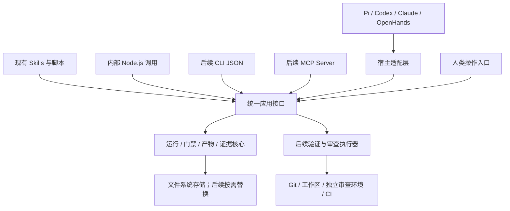

# Workflow 控制面：整体开发目标方案

状态：待实施的目标方案，不代表当前已具备全部能力。日期：2026-11-16。

[返回首页](../README.md) · [第一阶段详细方案](workflow-core-phase-one.md) · [当前架构](development.md)

## 1. 已确定的方向

以当前 `skills-init` 仓库为唯一主干，将已有 workflow-run 工作流内核整理为 Agent 无关的公共核心。先保留 Skills 能力，再逐步接入程序接口、CLI、MCP 和不同 Agent 的执行适配。

产品定位：**Agent 无关的研发流程协议与证据控制面。Agent 负责分析和实现，控制面负责运行状态、阶段门禁、决策关联和交付证据。**

不再让 `project-agent` 与本仓库分别演进一套工作流核心。该项目尚无用户，作为 Pi 接入、验证执行和审查执行的参考来源；有价值的实现经过审查后迁入主干，不整仓合并，不承诺兼容其接口。

本次重构不以旧用户兼容为约束：允许调整内部路径、脚本参数和状态格式，不建设旧数据迁移、双写或兼容入口。新版本 Skills 的安装、调用和功能必须形成闭环。“不兼容旧实现”不等于允许新版本缺少现有功能，也不意味着自动删除用户工作区中的旧数据。

## 2. 用户与价值

主要面向平台工程团队、技术负责人和需要流程一致性的研发团队。先在本地单项目工作流中验证，再决定团队服务化投入。

要解决的问题：

- 不同 Agent 对同一流程执行不一致，阶段事实依赖对话记忆。
- 需求、方案、实现、验证和审查之间的关联无法核验。
- 切换 Agent 或恢复会话后，需要重新调研或重复已确认的决定。
- 模型声明完成测试或审查，但证据来源和覆盖范围不明确。
- 规范只有文本约束，没有确定性的状态转换和交付检查。

非目标：通用 Coding Agent、IDE、通用 BPM、多 Agent 自动对话平台、模型平台。Web UI、远程执行和多用户权限不是近期前置条件。

## 3. 目标架构

### 3.1 单一核心

核心管理 run、revision、阶段转换、产物版本、批准绑定、代码快照、证据关联、交付门禁以及中断恢复。所有入口复用同一实现，Adapter 不另写状态机或复制门禁。

阶段规则由核心定义；宿主可以根据结构化状态决定怎样推进，但不能自行解释或改写“哪些证据满足交付”的规则。

### 3.2 应用接口与接入层

第一阶段提供内部 Node.js 入口。后续 CLI 和 MCP 将参数映射到该接口，负责输入输出、错误映射和身份上下文，不重新实现领域规则。

Skills 继续提供需求分析、澄清、执行方法及使用指引。Pi 等 Adapter 负责工具注册、会话接入、宿主事件和能力映射。验证及审查执行器负责实际执行并生成记录，与证据是否有效的判断分开。

### 3.3 存储

先继续使用文件系统、`meta.json` 和 Markdown 产物，保留 revision、写锁、原子替换与产物收尾恢复机制。按实际调用边界集中存储访问，不预先构造通用数据库框架。只有远程服务或多人并发带来明确需求时，才评估 SQLite 或服务端存储。

## 4. 三类契约

### 4.1 Workflow 契约

逐步定义版本化操作：运行创建与查询、checkpoint、产物收尾、验证、审查、方案批准、修复或交付选择、完成和取消。

正式外部协议需约定协议版本、运行标识、预期 revision、调用身份、前置条件、结构化结果与错误。对重试可能重复产生副作用的操作定义幂等规则；不要把 revision 检查误认为幂等。长时验证还需区分操作已接收、执行中、成功、失败和取消。

第一阶段只固定仓库内部接口，不提前发布外部协议版本，也不建设完整 Schema 注册体系。

### 4.2 Evidence 契约

证据至少关联运行、产物版本、代码快照、来源和覆盖范围。执行型证据逐步补充命令、工作目录、开始结束时间、退出码、工具版本、环境及脱敏输出。

| 等级 | 来源 | 能证明的范围 |
| --- | --- | --- |
| declared | Agent 或调用方提交的声明 | 记录了某项声明，不能单独证明命令执行 |
| observed | 可信范围内的执行器实际执行并记录 | 执行器观察到的输入与结果 |
| verified | 独立或干净环境中的复跑记录 | 在指定环境、输入和验证范围内复跑的结果 |

等级不由模型自填后自动升级。`verified` 也不等于测试充分、代码安全或业务一定正确。具体交付是否允许失败、未验证项及风险例外，由门禁策略决定，例外需记录范围、原因及决策来源。

哈希与哈希链主要校验内容一致性。若证据和摘要都可被同一主体重写，不能声称能检测所有伪造；更强的回溯校验需要受保护的摘要、签名或外部 CI 记录。

### 4.3 Adapter 契约

Adapter 声明能否拦截文件写入、Shell、使用沙箱、恢复会话和派遣独立审查。记录能力实际覆盖的工具、路径、进程与运行配置，不能只凭自报能力声称强制管控。

Observe / Controlled / Enforced 可作为展示等级，但必须附带边界。相同工作流契约不代表所有宿主拥有相同的执行限制。

## 5. 信任与权限边界

Agent 操作面负责状态查询、进度、产物与执行请求。Human 操作面负责批准、修复或交付选择、完成及取消等决定；操作归属以最终协议定义为准。

后续 Agent 接口不提供人类决策操作，但仅隐藏 MCP 工具或拆分 CLI 命令不构成可信身份隔离。同一操作系统身份下，Agent 可能直接调用命令或修改状态。只有独立凭据、受保护服务或隔离运行环境才可能提供更强边界。

第一阶段的内部 API 属于受信任的本地程序接口；它可以记录决定，但不认证真实批准人，也不阻止 Agent 直接修改文件。后续能力必须逐项验证后再对外承诺。

## 6. 阶段路线与退出条件

| 阶段 | 目标与主要交付 | 退出条件 |
| --- | --- | --- |
| 一：公共核心 | 核心边界、内部程序入口、Skills 接入、安装与测试闭环 | 两个入口操作同一 run，遵守相同门禁；现有 Skills 功能可用 |
| 二：协议入口与执行证据 | 版本化 CLI JSON、真实验证执行器、证据来源分级、MCP 薄封装 | 声明与实测不可混淆；失败、超时、快照变化、重试有明确行为 |
| 三：跨 Agent 接续 | 运行交接包、首个宿主适配、两个真实宿主交接 | 新宿主读取同一需求、方案、决定、代码和有效证据，继续到交付 |
| 四：证据独立校验 | 证据清单、verify、CI 校验、导出与脱敏 | 在明确可信前提下独立核验产物、快照和证据关联，发现失效和内容变化 |
| 五：按需求团队化 | 控制台、远程执行、团队存储及身份权限 | 试点证明收益，权限和执行边界经过验证，再扩大使用范围 |

顺序不是要求每阶段同时覆盖全部宿主。CLI 优先验证契约，MCP 复用接口；优先选择两个实际可用的宿主。Codex / Claude 可能只需 Skills、CLI 或 MCP 接入；只有出现宿主特定能力需求时才增加专用 Adapter。Pi 可优先复用参考项目中的经验，OpenHands 远程执行后置。

## 7. 跨 Agent 交接的最终验收场景

1. Agent A 创建 run，保存需求和方案，记录对应版本的人工决定。
2. 保存运行状态，停止 A；Agent B 使用生成的交接包恢复同一 run。
3. B 能获取真实代码和产物，识别已完成事项、未决问题、有效证据及下一步。
4. B 完成实现、验证、审查和交付；仍受同一套门禁约束。
5. 修改方案、代码或报告后，相应旧批准或旧证据不能继续满足交付。
6. 独立校验器报告证据链条、缺失项、例外和可信边界。

交接包由权威状态生成，不成为第二份可独立写入的运行状态。代码摘要不能重建未提交代码：同工作区交接与跨机器交接分开验收，后者需解决补丁、快照或提交的实际传输。

## 8. 衡量方式

北极星目标：**一个项目运行能否在不同 Agent 之间交接后继续完成，并产生可独立检查的交付证据。**

第一阶段先衡量入口一致性、完整流程成功率及安装后可运行性。跨 Agent 阶段再选 6～10 个真实 M/L 功能或缺陷，与现有 Skills 模式比较：交接后的重复工作、缺失或失效证据比例、交付完成率、总耗时、人工纠正次数和审查问题的实际有效性。

方案批准前写入次数只能在有相应观测能力的环境中统计；不能观测时标记未知。原始发现数量不能直接代表审查质量。安全保证和效率收益分别衡量，避免用支持 Agent 数量代替价值验证。

## 9. 仓库与实施原则

- 当前仓库是唯一主干，阶段一不新建第三个核心仓库，不拆分多个发布包。
- 新代码在独立开发分支实施，小步提交；设计文档提交不代表实现已经开始。
- 不为旧调用保留转发壳，不建设迁移工具；需要改变格式时明确拒绝不支持的数据，不静默重置。
- 先解决已存在的依赖，再决定目录细分；不引入通用插件总线、事件溯源或存储框架。
- 数据库、Nacos、Wiki、CodeGraph、DocNexus 等现有能力保持各自职责，不因抽取核心而扩张到远程执行平台。
- 不把方案讨论自动转化为审批、发布 npm、修改另一个仓库或执行实际业务流程的授权。

第一阶段的任务、接口边界、测试和完成定义见[详细开发方案](workflow-core-phase-one.md)。
